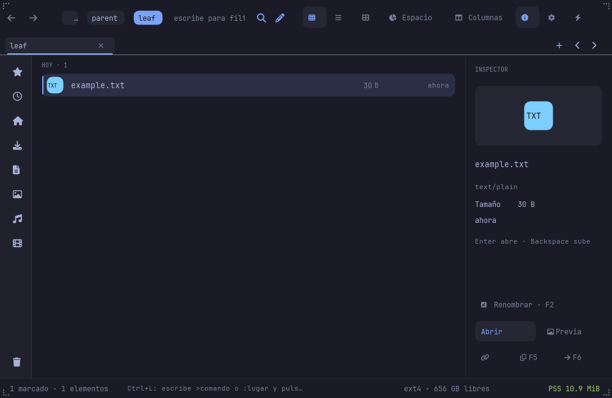
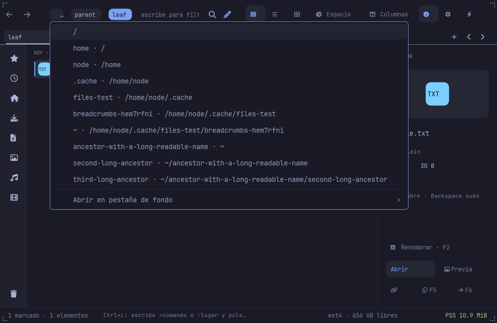
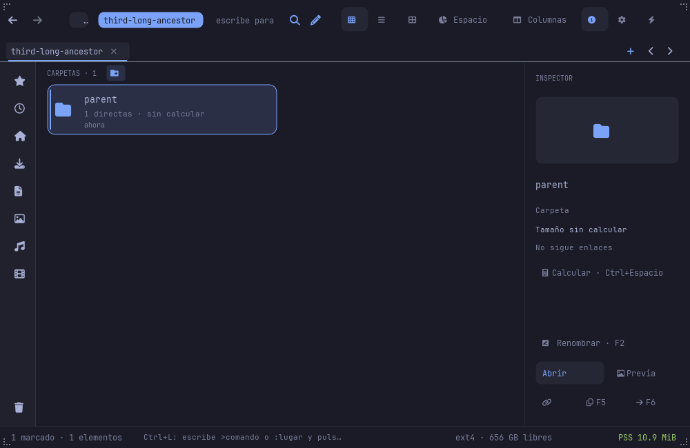

# Complete breadcrumb ancestry

Files no longer drops the oldest path components when the bar becomes
narrow. The `…` control opens the toolkit's animated, clamped/scrollable
PopupMenu with every hidden ancestor. `Alt+Down` opens the same menu;
Escape returns focus to the browser. A direct choice navigates, while the
background-tab submenu preserves the current listing and selection.
Middle-click on a visible ancestor uses the existing background-folder-tab
behavior; middle-click on `…` never activates its primary action.

## Layout and identity

Breadcrumbs use actual text measurement at the paint font/size, not character
counts. The layout keeps a fitting suffix with the current chip visible
where possible and reserves room for overflow. At tiny widths one fitting
button contains all targets. Hits use the same bounded rectangles as paint.
Ancestors above HOME remain accessible even when the home chip is `~`.

Targets remain exact PathBuf values, including non-UTF-8 components. Labels
are escaped display text; menus show the component first and parent context
second, abbreviating HOME to avoid obscuring the useful name with a repeated
prefix. The ancestry builder rejects relative, NUL and over-4096-byte inputs
before constructing prefix snapshots. No filesystem probes run in layout.

## Popup lifecycle

The adapter uses the shared toolkit menu manager. It captures owner/tab and
listing generation with the menu actions. Navigation, owner changes, edits
and covering surfaces invalidate the request. Picks are resolved from the
captured action/ID map, not the newly resized bar. The current location is
checked and disabled as a direct destination when it is in overflow.
The popup restores focus to the canvas; it creates no persistent file or
preference changes by itself. Existing mutation and background-tab admission
remain in force.

## Acceptance

`breadcrumbs.rs` tests home/root ancestry, exact raw names, escaped labels,
measured widths, bounded suffixes over 0..600 px, tiny viewports and path
limits. A menu-caption test protects component-first readability.
`scripts/breadcrumbs-ui-check.py` checks real painted bounds, complete
ancestry, pointer and Alt+Down opening, Escape, exact ancestor navigation,
hidden/visible ancestor background tabs and ignored auxiliary overflow.
It runs with `--animations on|off` and supports `--binary` after installation.
It uses private fixtures and actual framebuffers; handler tests do not claim
native OS input coverage. Existing path-edit and toolkit-menu checks cover
related interactions separately.

Run GUI checks under Xvfb or the private nested compositor. Native ARM
artifacts must be built and validated on M2 before installation. Both hosts
back up and hash the five installed artifacts and check the installed binary.
Resource/startup gates remain unmeasured. This delivery does not close the
full Nautilus/Finder, accessibility or language roadmap.

## Validated delivery 74d205f

Installed app hashes start `2b98655c34c5` on NODE and `c2bb095e8a84` on
native aarch64 M2. The scenario passes with animations both on and off on
each architecture; both installed binaries pass with animations on.
NODE path-edit and existing toolkit-menu regressions pass. Workspace:
1,665 passing tests, three ignored; Clippy and release checks pass.
All five installed artifacts and prior backups match their recorded hashes
on each host. Unchanged native HTML helpers were reused after recipe checks.

| Deep path | Hidden ancestors | Selected ancestor |
|---|---|---|
|  |  |  |

Reports, full logs and installation audits are retained under
`evidence/breadcrumbs-20261106` and the linked scene reports. Earlier
functional snapshots retain the component-label readability refinement.
