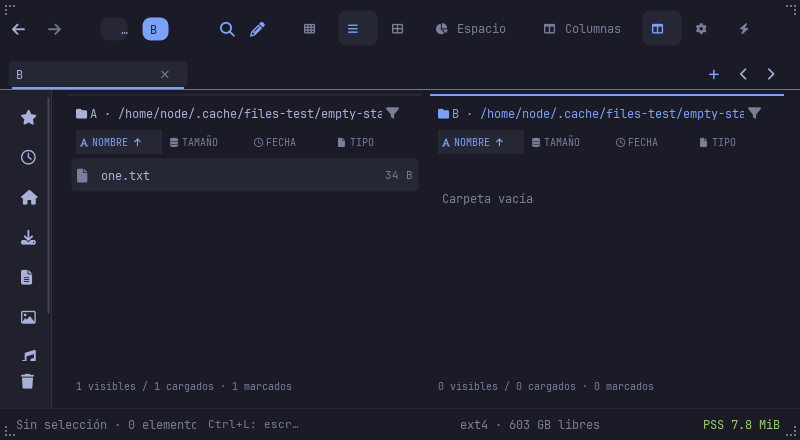
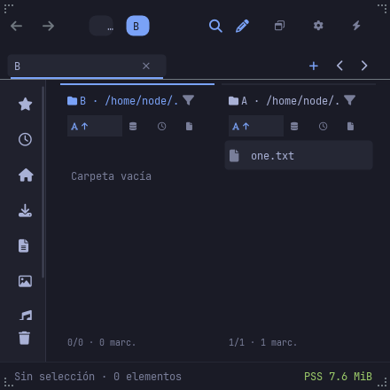

# Browser empty-state ownership

The top-level browser painter previously drew an empty/loading message after
the dual-pane and Columns painters had already drawn their own. When the
active pane was empty, that global message could overlap files in the other
pane. Columns could show duplicate messages.

Each surface now owns its empty body. The single-browser fallback excludes
dual pane, Columns and SpaceMap. Dual pane and Columns keep their existing
clipping and placement; SpaceMap retains its specialized state.

The shared text resolver distinguishes a listing error, a pending listing,
an active filter with no results and an empty folder. Explicit errors take
priority over loading text. Short labels fit narrow panes. This does not
change navigation, selection, ordering, scrolling, listing workers or actions.

Three Painter regression tests cover the single-browser state matrix,
either empty dual pane with a populated sibling at minimum/normal sizes,
and scoped Columns states with populated neighboring columns. Private
framebuffer scenes cover the actual window and unchanged fixture payloads.
They are handler/render evidence; native OS input and resource/startup
acceptance remain separate.

## Validated installation — 2026-11-06

Application `acdc119`, fixture `b3d7a92`: 1,675 workspace tests passed
(723 core, 112 helper, 840 UI; 3 ignored), including the three Painter
regressions. Clippy and native release builds passed. Private source and
installed scenes passed on NODE and native ARM M2, each with 28 states,
9 captures, two normal closures and unchanged fixtures. Installed keyboard
matrix regressions passed on both machines.

| Machine | Installed app SHA-256 |
|---|---|
| NODE x86_64 | `ef081178d1af2ce3102583808a7dae72886b74f772fbd8950ac1bc06750f92f2` |
| M2 native ARM | `b8aa4a481b971bd2c51d570e59ae476ab8e470a14c31ce96823dd93239bf5907` |

All five installed and backup artifact hashes were checked. Unchanged native
HTML helpers were reused after recipe verification. See the
[evidence bundle](evidence/browser-empty-20261106/README.md).

