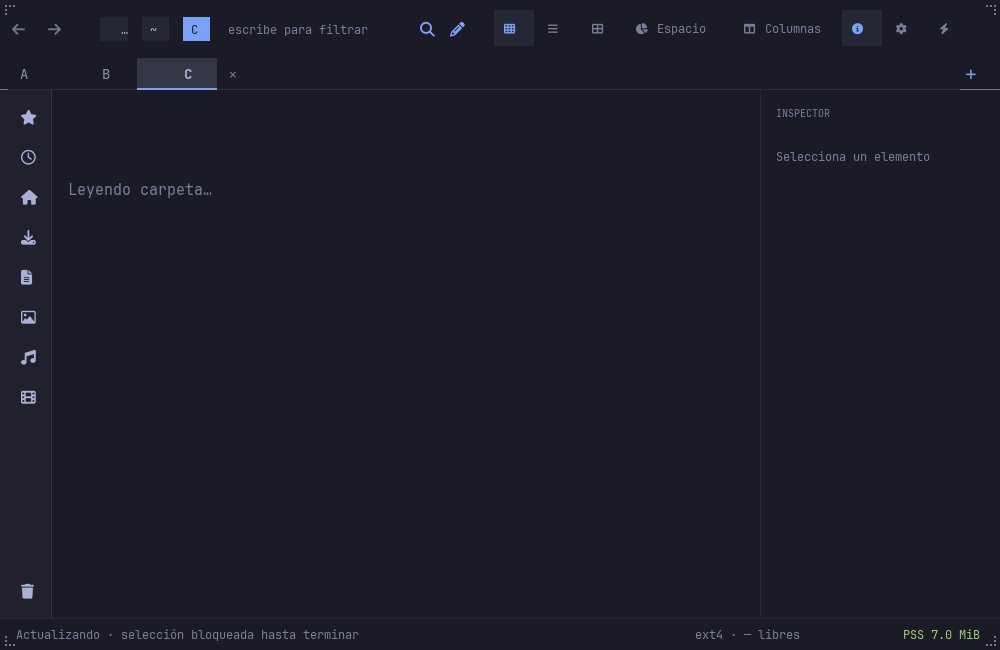
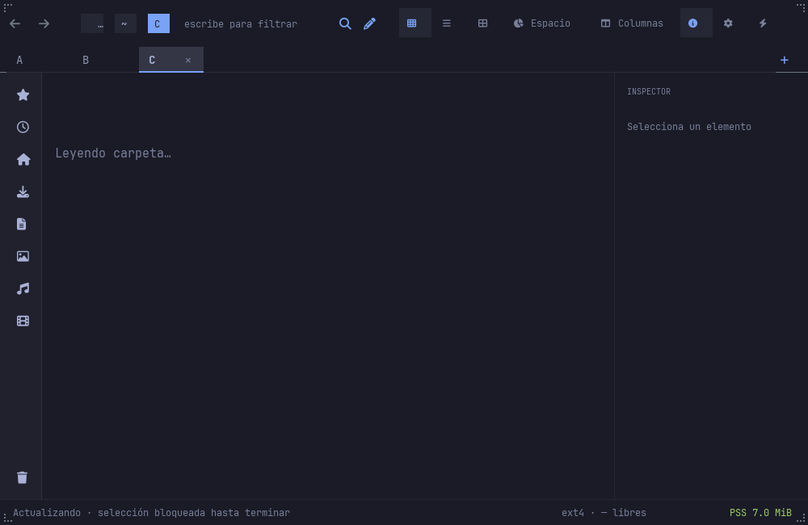

# Toolkit keyed tab strip

Files uses `KeyedTabBar<(pane_id, tab_id)>` from the exact toolkit export
`a029d45`, based on the keyed API in `89632dc`. Titles are presentation;
raw paths, tab snapshots, history and admission remain owned by Files.
Optional GPU, accessibility and media features remain disabled.

## Interaction

Primary clicks select on release. Dragging reorders without first activating
the source tab; dropping outside or pressing Escape cancels the gesture.
Middle clicks request closure of the indicated tab. Right clicks on the
body or close hit open its context without activation. Overflow scrolls
within the widget, preserving the current browser.

`Ctrl+Alt+T` focuses the tab cursor; Escape returns to the browser without
clearing its selection. Left/Right/Home/End select; Alt+Left/Right moves only
the cursor; Ctrl+Shift+Left/Right reorders the cursor tab; Enter activates it;
Delete closes it; Menu/Shift+F10 opens its context. Ctrl+Shift+F10 always
targets the active tab. Keyboard-origin menus restore strip focus, while
browser-origin menus restore browser focus. Existing Ctrl+Tab cycling and
Ctrl+Shift+PageUp/PageDown active-tab ordering remain available.

The toolkit fix in `a029d45` explicitly reveals a repeatedly selected key.
This covers Home after moving the independent cursor to an overflowed last
tab while the first tab remains active.

## Ownership and rendering

Widget callbacks enqueue bounded requests and never borrow the app model or
rewrite the selected State during notification. Each request carries the
displayed pane/active-tab owner and listing generation. Draining before the
session pump preserves user intent against late startup restoration.
Pointer presses and explicit strip focus also cancel pending restoration
when the selected key is unchanged and emits no State notification.
Missing/foreign/stale keys, covered surfaces and active edits or mutations
reject requests. Consecutive selection requests from one display stamp keep
the final intent. Rejected local selection changes are reconciled to the
accepted app state on the next paint.

The app synchronizes the ListModel and selected State under a notification
guard. Stable keys preserve toolkit item identity across labels and moves.
The existing snapshot controller admits all tab closures and navigation;
the strip never removes snapshots itself.

A background-owning Group clears its own rectangle before drawing the
transparent toolkit control, including animation timer frames. Its default
pre-draw is disabled. The toolkit owns indicator timing, easing and the
reduced-motion policy. Files exports actual widget body/close geometry after
drawing and refreshes it after independent scrolling or cursor movement.
The native window bridge remains in place. Auxiliary strip events reach the
widget's release handler once; other auxiliary browser gestures retain their
existing route. The toolkit focus router is installed for native keyboard
mode and focus rings.

## Acceptance

`scripts/keyed-tabs-nested-check.py` exercises native pointer/key delivery
only on an isolated nested Wayland socket. It records actual mapped sizes
separately from requested sizes. `scripts/tab-strip-motion-ui-check.py`
checks eight frozen-clock rendered snapshots: intermediate indicator bounds,
rapid reversal, a single underline, settled ON/OFF equality and disabled
motion reaching its endpoint in the input frame. Full rendered snapshots
do not independently establish partial-damage screen behavior.

Model tests cover request ownership, stale targets, bounded input,
programmatic synchronization and selection bursts. Existing context,
keyboard, Sidebar, preview and native transfer acceptance remain relevant
regressions after focus-router adoption. Installation evidence records the
exact app/helper hashes and all five installed/backed-up artifacts per
machine. Native macOS/Windows, full accessibility/i18n, tear-off and the
remaining Nautilus/Finder roadmap are separate open requirements. Resource
and startup gates remain `NOT_MEASURED`.

## Validated installation — 2026-11-06

Application checkpoints `a0f1fff` and `e47cf81` passed 1,679 workspace tests
(723 core, 112 helper, 844 UI; 3 ignored), Clippy, formatting and native
release builds. The installed `e47cf81` artifacts passed native tab/focus/
startup-intent checks, keyboard selection matrices, preview copying and
Sidebar drops on NODE and native ARM M2. Eight rendered motion snapshots
pass on each architecture. All five installed and backup artifacts were
hashed; unchanged native HTML helpers were reused after recipe verification.

| Machine | Installed app SHA-256 |
|---|---|
| NODE x86_64 | `5336f0624f4e155145e933f40819353124859ad0fa6fbd4c8b3857d3d572170d` |
| M2 native ARM Linux | `a891a7be055ba81951aca401c6bf7ef0639a13539a9f82d099b3b9ee327762e4` |

The native compositor assigned 508×325 on NODE and 810×449 on M2; requested
window sizes are recorded separately. The frozen-clock rendering scene uses
a fixed 1000×650 viewport. Native action checks and rendered snapshot checks
therefore have different viewport/input scopes. The pointer context menu
opens at the click position and can overlap the strip behind it; keyboard
context anchors below the strip. No direct partial-damage screen comparison
was performed in Files.

Reports, intermediate failures, captures, logs, receipts and artifact audits
are in [the evidence bundle](evidence/keyed-tabs-20261106/README.md).

