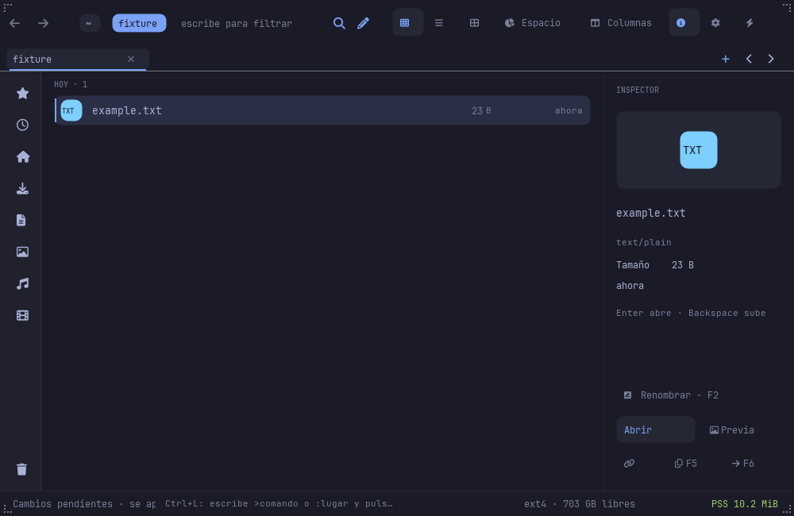
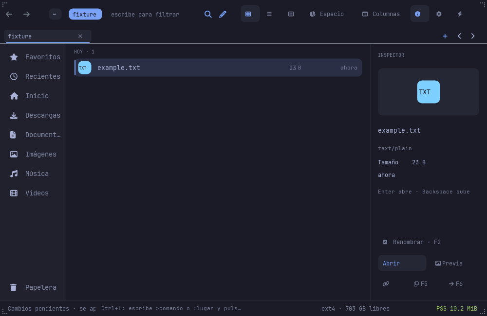
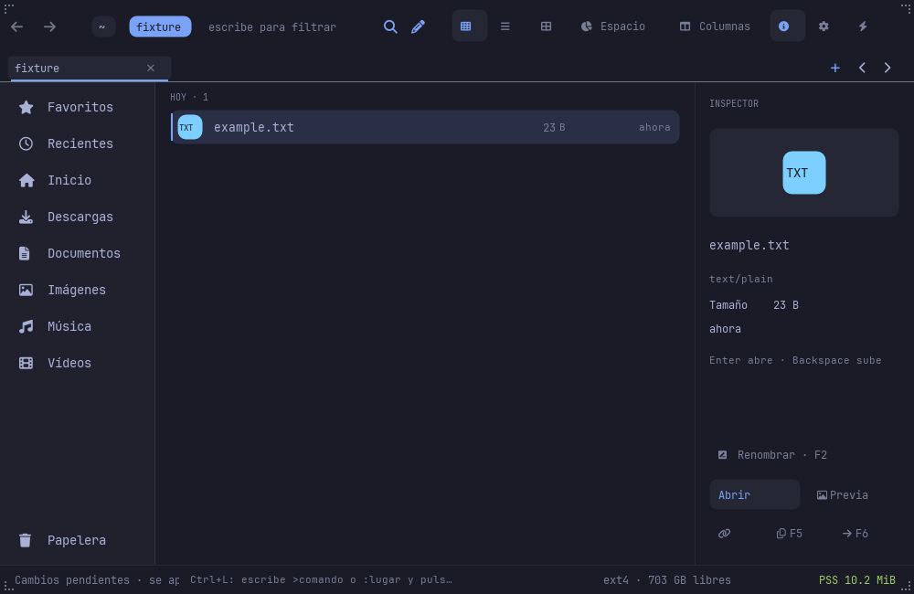

# Sidebar motion and browser geometry

The toolkit Sidebar lives over the Files canvas, outside a toolkit Flex.
Its Push mode therefore resizes directly instead of animating layout.
Previously, Files also forced the widget to 52 or 170 px every paint and
used the expanded boolean for every browser inset. Expanding the rail
moved the entire listing in one jump.

## Shared geometry

Files now samples `fltk_omarchy::anim::Anim<f64>` with the toolkit's layout
duration (190 ms, OutCubic). This uses the toolkit's shared clock, reduced
motion setting and redraw scheduler. It does not start a second animation
timer or patch the vendor.

The same rounded width sizes the real widget and `Model::rail_width()`.
`browser_left()` adds the existing 16 px gutter. Listing paint/hits, grid
width, keyboard reveal, scrolling, context menus and operation feedback
all consume those helpers. Labels still use the logical expanded state.
Offscreen scenes and covered browsers keep their original endpoint layout.
FLTK child scaling on window resize is repaired using the sampled width.

When a canvas modal covers the browser, the Sidebar is hidden and the
width animation settles. Reversals interpolate from the current width;
turning animations off immediately reaches the endpoint. Row drop targets
are taken from the widget after the frame is drawn.

## Acceptance

- `sampled_sidebar_width_keeps_listing_hits_and_operation_layout_aligned`
  verifies 52/94/136/170 px under both logical states, including listing
  hits, grid and operation feedback. Covered/offscreen geometry ignores a
  retained widget sample.
- `scripts/sidebar-motion-ui-check.py` drives a private fixture command.
  The toolkit motion gate renders offscreen frames on its frozen clock,
  tracks the actual Sidebar edge, browser inset and first entry hit, and
  detects jumps/pops/overshoot. It checks intermediate widths, monotonic
  expansion/collapse, quick reversal, resize, pinning, modal coverage and
  reduced motion. Three snapshots retain collapsed/moving/expanded states.
- Existing Sidebar interactions and real Wayland drag checks remain
  separate: internal rendered-frame tests do not prove OS input delivery.
- Run GUI checks under Xvfb or the private nested compositor. The motion
  runner accepts `--binary` to validate the installed artifact as well.

Resource/startup gates remain `NOT_MEASURED`. This change does not claim
complete Nautilus/Finder parity; tab gestures, breadcrumb overflow and the
remaining navigation matrix are tracked in the UI implementation plan.

## Rendered states on NODE

| Collapsed | Moving | Expanded |
|---|---|---|
|  |  |  |

The snapshots come from actual rendered frames, not a mockup. The report
stores frame-by-frame geometry as well as the three pictures.

## Validated delivery

Source checkpoint `de480ce` is installed on NODE (`d5ea66b1cebb`) and native
ARM M2 (`f55074e70716`). Both installed binaries pass the rendered motion
fixture and the real private Wayland drag-and-drop check. The existing
Sidebar scene passes on each architecture; narrow-name checks pass on NODE.
The workspace has 1,653 passing tests and three ignored tests; Clippy and
release checks pass. All five prior installed artifacts and their hashes
are preserved and checked on both machines.

Evidence is retained under `evidence/sidebar-motion-20261106` and the linked
scene reports. Setup failures remain recorded: the first motion runner
read a JSON line before its newline (fixed in the runner), and the first
minimal ARM source export omitted the compile-time theme (completed from
the same source checkpoint). Neither required weakening a functional gate.
