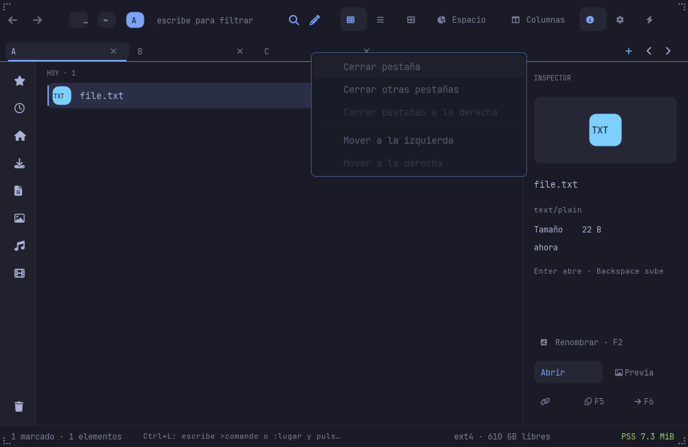

# Tab order and context actions

Right-click on a tab opens that tab's actions without selecting it first.
The menu closes the indicated tab, closes other tabs, closes tabs to its
right, or moves it left/right. Unavailable moves and closures are disabled.
`Ctrl+Shift+F10` opens actions for the active tab. `Ctrl+Shift+PageUp` and
`Ctrl+Shift+PageDown` move the active tab without changing its browser.

## Stable application ownership

Commands use stable tab IDs and insertion-before IDs, never a cached row
index. Reordering preserves active ID, path, history, filter, selection,
anchor, listing generation and the other pane. The toolkit popup captures
owner/tab and generation; stale or covered contexts are discarded.

Batch closures retain the clicked tab and never close the final tab. A
background-only closure leaves the active browser untouched. If the active
tab is among those explicitly closed, the retained clicked tab is activated
after admission, rather than before opening the context menu. Admission
accounts for the incoming snapshot, outgoing active snapshot, closed-history
evictions and the other pane before removing any tabs. Existing edits and
mutation guards remain in force. Closed snapshots use the normal reopen
history.

The model/controller is also the intended endpoint for the toolkit's keyed
TabBar context and reorder requests. Files does not export uncommitted
upstream work or duplicate the toolkit's indicator animation while that API
is being validated. Drag reordering and the native widget migration remain
open; these menu/keyboard actions are independently usable now.

## Verification

Model tests cover stable insertion, stale/self/no-op targets, edit guards,
background state preservation, active snapshot admission, visual-order
CloseRight, shared-budget rejection without partial removals, and multiple
closed-history evictions. `scripts/tab-context-ui-check.py` checks the real
painted app actions and toolkit popup/key routes under private fixtures,
including focus/Escape, keyboard movement and inactive survivor activation.
It supports `--binary` and `--animations on|off`. These are handler/render
checks, not a native OS mouse/keyboard claim.

The keyboard navigation matrix was also repaired against the current
SpaceMap contract: Ctrl+Shift+End selects the complete inclusive range,
retaining the anchor and distant marks. It no longer expects one mark.
The runner supports installed binaries, private HOME/XDG fixtures and
newline-complete JSON records. No production selection behavior was reverted
to make the old test pass.

The native ARM run exposed a second fixture race: initial watch attachment
admitted a listing refresh while the runner sent Ctrl+Shift+Down. Navigation
is intentionally consumed during selection restoration. Harness checkpoint
`8ae0de8` waits for the current watch and active pane to be ready before each
action and tests predicates against the newest complete state. It does not
replay keys or disable production guards. The failed run is retained.

## Validated installation — 2026-11-06

Application checkpoint `1c2cdee` passed 1,672 workspace tests (3 ignored),
Clippy and release builds. Context scenes pass with animations on/off on
NODE and native ARM M2; installed context and corrected keyboard matrices
pass on both machines. NODE breadcrumb and general menu regressions pass.
The first concurrent Xvfb menu run lost its display connection; its failure
is retained alongside the isolated passing run. Future Xvfb runs use
separate display numbers or sequential startup.

| Machine | Installed app SHA-256 |
|---|---|
| NODE x86_64 | `b7a8b73f2b1d9220c86234f8a0242c7627ecab4041fc23f5da2c80c5fc2546a5` |
| M2 native ARM | `3c419230f12d9506efcf52b4fe3499c955ac27de7597b27d47ceea174b6c538d` |

All five installed and backup artifacts were hashed and verified per machine.
The unchanged native HTML helpers were reused after recipe verification.
Reports, captures, installation receipts, audits and build/test logs are in
[the evidence bundle](evidence/tab-context-20261106/README.md).

Resource and startup acceptance remain unmeasured; this delivery does not
close the complete UI, accessibility, language or Nautilus/Finder roadmap.
