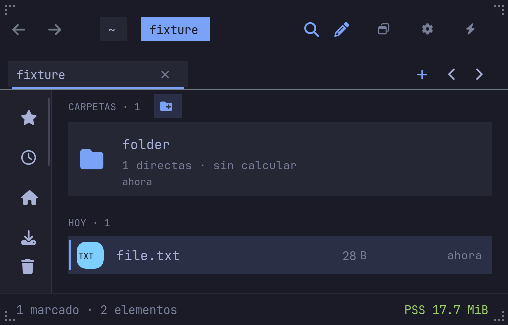
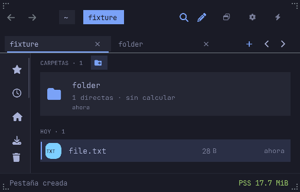

# Background folder tabs and auxiliary pointer gestures

Middle-click on a visible folder opens a metadata-only tab without selecting
the folder or changing the current path, selection, anchor, filter, history
or listing worker. List, Groups, Grid and Columns resolve the painted entry;
dual-pane entries carry their owner and revision. A folder in the inactive
pane opens in that pane's tab group while focus stays in the active pane.
Mounted locations and folder bookmarks use their actual Sidebar row bounds.
Breadcrumb folder targets use their stored path. Files and unsupported
controls ignore middle-click.

Middle-click on a tab body or its close button closes that stable tab ID
without selecting it first. Closing the active/final tab uses the existing
switch/close-pane/close-window behavior and admission guards. Ctrl-click
continues to toggle selection; it is not repurposed as a tab gesture.

## Routing and admission

The window handler must run before FLTK's group handler: otherwise the
canvas or Sidebar can process the same event as a primary click before the
auxiliary action runs. The auxiliary press/drag/release sequence is consumed;
unsupported auxiliary buttons cannot fall through to destructive primary
controls. Primary clicks, context menus and native clipboard/DnD routing
keep their own handlers.

Folder resolution reads bounded current model data and stable column/pane
identity. It does not stat files or switch panes to discover a target.
Admission reuses the existing count, retained-byte and raw-path validation;
all targets are prepared before IDs are published. Background tabs do not
start additional listing or preview workers. Modals, menus, edits and busy
mutation surfaces block the gesture. F1 documents both middle-click actions.

## Verification

- Model regression tests cover raw names, exact active state preservation,
  clicked-pane ownership, stale/hidden targets, shared byte/count limits and
  failed admission without consuming an ID.
- `scripts/tab-gestures-ui-check.py` drives the production gesture function
  on painted targets in a private fixture. It checks background admission,
  body/close-button closure, ignored controls, blocked surfaces, List/Grid/
  Columns and inactive-pane ownership.
- `scripts/tab-middle-nested-check.py` sends real BTN_MIDDLE through a
  virtual pointer to a PID-verified Files window in a private compositor.
  It checks folder admission, inactive tab closure and ignored file clicks.
- Tests wait for the listing watcher to settle before taking a generation
  baseline. Native input validation is separate from model/handler checks.
- Both runners retain reports, logs and real framebuffers and accept
  `--binary` for scoped post-install checks. Run handler checks under Xvfb
  or `nested-run.py`; native checks create their own hidden compositor.

This is an incremental usability delivery, not full tab or Finder parity.
Tab reordering/tear-off, complete shortcut customization and native macOS
validation remain separate work. Resource/startup gates remain unmeasured.

## Validated delivery c52b96b

The checkpoint is installed on NODE (`933201a53048`) and native ARM M2
(`5e613aa3c694`). The handler matrix and real middle-button check pass on
both architectures; installed native checks and real Wayland DnD regressions
also pass. NODE additionally passes the toolkit menu regression. Workspace:
1,657 passing tests, three ignored; Clippy and release checks pass.
All five installed artifacts and prior backups were verified by hash on
both machines. Native HTML helpers were reused after recipe verification.

A successful background open uses a brief status-bar message, never a
persistent operation card over file rows. Both middle-click gestures are
listed in F1.

| Original selection | Background tab, same selection |
|---|---|
|  |  |

Evidence, including setup and regression failures, is retained under
`evidence/tab-gestures-20261106` and the scene reports. The first native
check exposed child-before-window dispatch changing selection; the window
interceptor now runs first. Earlier handler checks also exposed an unstable
watcher baseline and a fixture resolving active Columns entries from its
inactive cache. Those failures remain recorded with the subsequent passes.
